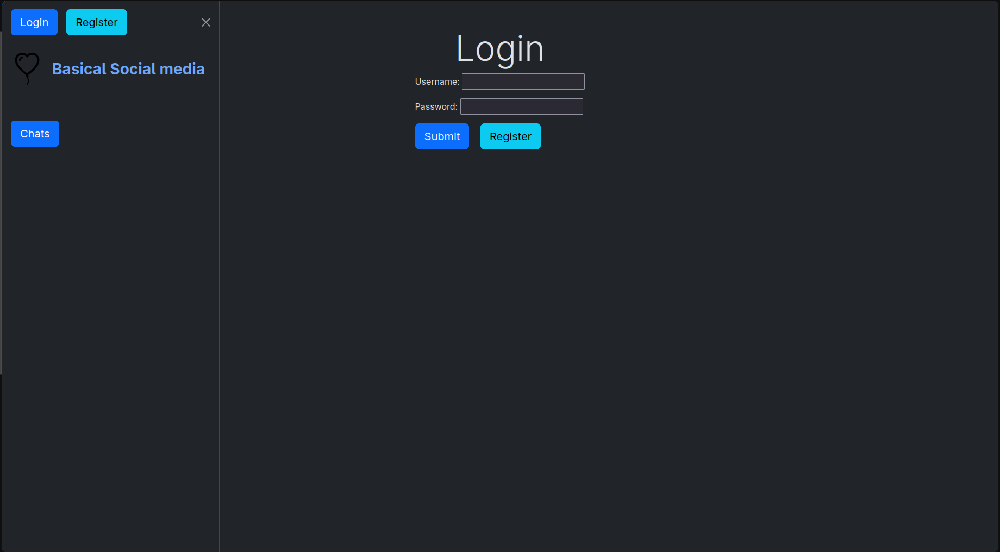
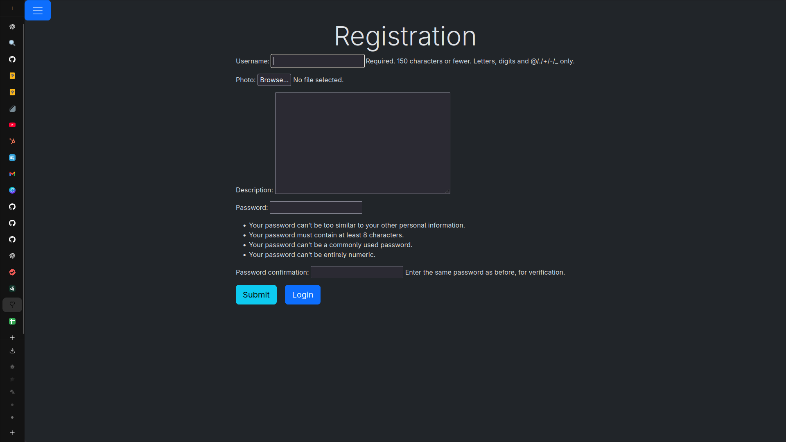

# Django Social Media App - My First Django Project

This is my first Django project, created while learning Django from scratch as a student. It's a basic social media platform that helped me understand the fundamentals of Django, including models, views, templates, authentication, and database relationships.

## About This Project

As a beginner in Django, I built this application to practice core concepts like:
- Setting up a Django project and apps
- Creating custom user models
- Implementing authentication (login, registration, logout)
- Working with models and relationships (OneToMany, ManyToMany)
- Building class-based views
- Handling forms and file uploads
- Using Django templates and static files
- Basic database operations with SQLite




## Features

- **User Authentication**: Custom user model with registration, login, and logout
- **User Profiles**: Users can add descriptions and profile photos
- **Posts**: Users can create posts with text and images
- **Channels**: Group-based content with members and followers
- **Chat System**: Private messaging between users
- **Responsive UI**: Clean templates for desktop and mobile

## Installation

1. Clone the repository:
   ```bash
   git clone https://github.com/yagodanr/social_media.git
   cd social_media
   ```

2. Create a virtual environment:
   ```bash
   python -m venv venv
   source venv/bin/activate  # On Windows: venv\Scripts\activate
   ```

3. Install dependencies:
   ```bash
   pip install -r requirements.txt
   ```

4. Run database migrations:
   ```bash
   python manage.py migrate
   ```

6. Run the development server:
   ```bash
   python manage.py runserver
   ```

7. Open your browser and navigate to `http://127.0.0.1:8000/`

## Usage

- **Registration**: Create a new account at `/register/`
- **Login**: Log in at `/login/`
- **Main Feed**: View all posts at the home page `/`
- **User Profiles**: View user details at `/user/<id>/`
- **Channels**: Explore channels at `/channel/<id>/`
- **Chat**: Access chats at `/chats/`
- **Admin Panel**: Manage content at `/admin/` (requires superuser)

## Project Structure

- `auth_sys/`: User authentication and profiles
- `social_media/`: Posts, channels, and main feed
- `chat/`: Chat functionality
- `project/`: Django settings and configuration
- `templates/`: HTML templates
- `static/`: Static files (CSS, JS, images)

## Technologies Used

- Django 5.0.6
- SQLite (default database)
- Pillow (image handling)
- HTML/CSS/JavaScript

## What I Learned

Through this project, I gained hands-on experience with:
- Django's MTV (Model-Template-View) architecture
- URL routing and view functions
- Template inheritance and context passing
- Form handling and validation
- File uploads and media management
- User authentication and permissions
- Database design and migrations
- Basic front-end integration with Django templates

## Future Improvements

As this was my first project, there are many areas for enhancement:
- Add real-time chat with WebSockets
- Implement notifications
- Add more advanced features like likes, comments, and follows
- Improve UI/UX with modern frameworks
- Add testing and deployment configurations

## Contributing

This is a learning project, but feel free to fork and experiment! If you have suggestions for improvements, especially for a beginner's perspective, I'd love to hear them.

## License

This project is licensed under the MIT License - see the [LICENSE](LICENSE) file for details.